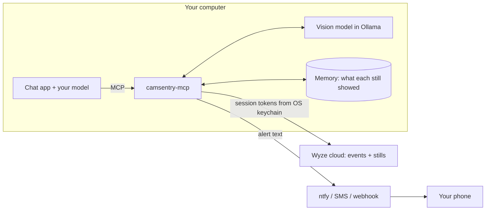

<p align="center">
  
</p>

<p align="center">
  <a href="https://github.com/14manj01/camsentry-mcp/actions/workflows/ci.yml"></a>
  <a href="LICENSE"></a>
  
  <a href="https://modelcontextprotocol.io"></a>
  
  <a href="SECURITY.md"></a>
</p>

<p align="center">
  <a href="#quick-start">Quick start</a> ·
  <a href="#what-it-does">What it does</a> ·
  <a href="#tools">Tools</a> ·
  <a href="#alerts">Alerts</a> ·
  <a href="#notifications">Notifications</a> ·
  <a href="#settings">Settings</a> ·
  <a href="#security">Security</a> ·
  <a href="#limitations">Limitations</a>
</p>

---

**camsentry-mcp** is an unofficial [MCP](https://modelcontextprotocol.io) server that gives a local model
eyes on Wyze cameras. A small vision model on your own machine looks at every still your cameras record,
remembers what it saw, and sends a message to your phone when something matters:

> **Person seen at Front Door:** A courier in a blue uniform places a box on the step. (10:42 AM)
>
> **Someone is lingering at Back Door:** A person has been in view for about 7 minutes. A man stands by the gate. (11:16 PM)

Your chat model can ask it anything: *"what happened out back today?"*, *"find the white van"*,
*"tell me if the gate is left open"*.

> [!NOTE]
> **Independent project.** camsentry-mcp is not affiliated with, endorsed by or sponsored by Wyze Labs, Inc.
> "Wyze" and "Wyze Cam" are trademarks of Wyze Labs, Inc., used here only to say which cameras this
> software works with.

## Quick start

**You need:** Python 3.12 – 3.14, a Wyze account, and [Ollama](https://ollama.com). Nothing else:
no Docker, no GPU libraries, no accounts with anyone but Wyze.

```sh
pipx install git+https://github.com/14manj01/camsentry-mcp   # or: uv tool install git+https://...
ollama pull qwen2.5vl:3b                                      # the 3 GB vision model that looks at the stills
camsentry-mcp setup                                           # sign in to Wyze, choose how to be notified
```

`setup` asks for your Wyze email, password and a free [API key](https://developer-api-console.wyze.com/#/apikey/view),
exchanges them for session tokens kept in the OS keychain, and discards the password and key.
It then prints the block to paste into your chat app's MCP settings (LM Studio, Jan, Open WebUI via mcpo,
ollmcp, …). There is nothing secret in it and nothing to configure:

```json
{
  "mcpServers": {
    "camsentry": { "command": "camsentry-mcp" }
  }
}
```

<details>
<summary>The same thing for <b>opencode</b> (<code>~/.config/opencode/opencode.json</code>)</summary>

```json
{
  "mcp": {
    "camsentry": { "type": "local", "command": ["camsentry-mcp"], "enabled": true }
  }
}
```

</details>

That is all. While the chat app runs, the cameras are watched and alerts reach your phone. To keep watching
when it is closed, run `camsentry-mcp autostart on`: the watcher then starts in the background each time
you log in (`autostart off` undoes it). `camsentry-mcp watch` runs it in a terminal instead.

## What it does

How it compares with what smart-camera services advertise:

| Smart-camera feature | camsentry-mcp |
| --- | --- |
| Tell people, pets, vehicles and packages apart | ✅ By a local vision model, per still. |
| Alerts that describe what happened | ✅ The local model writes the sentence you receive. |
| Fewer pointless alerts | ✅ One message when something starts, not one per still. Pets and vehicles stay quiet by default. A person is only reported after a second look agrees. Each camera can be told what it may text about. |
| Alerts that understand context | ✅ Person lingering, package gone after someone was there, a person during armed hours. |
| Teach it what to look for | ✅ Watch rules in plain words ("the gate is open"). Approximate: see [accuracy](docs/ACCURACY.md). |
| Urgent alerts stand out | ✅ Intruder and package-taken alerts are sent with top priority. |
| Search what the cameras saw in plain words | ✅ "dog in the yard", "white van": over the description of every still. |
| Timeline of the day | ✅ Stills pieced together into visits, with what changed between them. |
| Processing stays in your home | ✅ Images never leave your machine. Only the alert text goes to the notification service you choose. |
| Works with other systems | ➖ Outgoing webhook per alert. The server itself cannot control devices, on purpose. |
| Familiar faces | ❌ Not yet. On 55 real stills a face detector found no face: the stills are 640×360. |
| Live view and video clips | ❌ Stills only: what the Wyze app shows in its Events tab. |



## Tools

What your chat model can call. It does not need vision: everything comes back as text.

| Tool | What it does |
| --- | --- |
| `list_cameras` | Cameras, arming state, how you are notified, what each camera may text about. |
| `watch_cameras` | What the cameras saw that the model has not been told yet. |
| `get_timeline` | Recent visits per camera: when, who and what, what changed, a still-by-still story. |
| `search_events` | Find stills by words, e.g. `dog in the yard`. |
| `analyze_camera` | Run the vision model on a camera's latest still (or a named event) now. |
| `view_camera` | Return the still itself, for chat models that accept images. |
| `get_events` | Wyze's raw event list with ids. |
| `set_armed` | `on` / `off` / `schedule`: when a person counts as an intruder. |
| `add_watch_rule`, `list_watch_rules`, `remove_watch_rule` | Custom things to look for, e.g. "the garage door is open". |
| `set_camera_alerts` | Which alerts one camera may send to your phone, e.g. no `person` texts from a street-facing camera. |
| `notify_user` | Send you a short message. It always goes to the destination you set up; at most 6 per hour. |

If a model changes what you are alerted about (`set_armed`, `set_camera_alerts`, `remove_watch_rule`), your
phone is told, so alerts cannot be quietly switched off.

<details>
<summary><b>Example: one still as the model sees it</b></summary>

```json
{
  "event_id": "…",
  "camera": "Front Door",
  "time": "2026-03-01T23:41:07-06:00",
  "armed": true,
  "detection": {"people": 1, "pets": [], "vehicles": 0, "packages": 1, "suspicious": false, "suspicious_reason": "", "summary": "A courier places a box on the porch."},
  "alerts": [
    {"type": "intruder", "reason": "person detected while armed", "priority": "urgent"},
    {"type": "person", "reason": "1 visible", "priority": "normal"},
    {"type": "package", "reason": "1 visible", "priority": "normal"}
  ],
  "new_alerts": ["intruder", "person", "package"],
  "changes": ["person arrived", "package appeared"]
}
```

</details>

## Alerts

| Alert | Raised when | Sent to phone by default |
| --- | --- | --- |
| 🚨 `intruder` | A person while armed, or behaviour the model flags as suspicious (testing a door, taking a package). | yes, urgent |
| 📦 `package_taken` | A package that was in view is gone after a person was there. | yes, urgent |
| 🕒 `lingering` | A person is in consecutive stills for 3 minutes or more. | yes |
| 🧍 `person` | A person is in view. | yes |
| 📦 `package` | A package is in view. | yes |
| 📌 `rule` | One of your watch rules became true. | yes |
| 🚗 `vehicle` | A vehicle is in view. | no |
| 🐾 `pet` | An animal is in view. | no |

An alert is sent when it becomes true, not for every still in which it stays true: a parcel sitting on the
porch all afternoon is one message. Wyze's own tags (Cam Plus) raise the same alerts when present.

> [!WARNING]
> Treat alerts as a prompt to look, not as proof. A small model reading 640×360 stills makes mistakes;
> [docs/ACCURACY.md](docs/ACCURACY.md) has the numbers. Do not rely on this as your only security system.

## Notifications

Chosen in `camsentry-mcp setup`, changed with `camsentry-mcp notify …`. Destinations live in the OS keychain.

| Channel | Command | Cost | What leaves your machine |
| --- | --- | --- | --- |
| **ntfy** push (recommended) | `notify ntfy` | free, no account | Alert text, to ntfy.sh or your own ntfy server. You install the ntfy app and subscribe to a private topic. |
| **Email** | `notify email` | free | Alert text, through your own mailbox to yourself. Needs an app password for that mailbox (Gmail, Outlook, Yahoo and iCloud servers are known; others ask for the server name). |
| **SMS** | `notify sms` | a few cents per text | Alert text and your number, to textbelt.com. You buy a key there; its free key does not send to US numbers. Some antivirus products block that site. |
| **Webhook** | `notify webhook` | free | Alert as JSON (`title`, `body`, `urgent`) to a URL of yours: Home Assistant, Discord, Slack. |

`camsentry-mcp notify test` sends a test; `camsentry-mcp notify off` removes every destination.

An email address alone is not enough to be notified: something has to send the mail, and the free services
that used to send to any address (ntfy.sh's email, Textbelt's free texts) have closed that door because of
abuse. So email goes out through a mailbox you already own. If your mobile carrier still offers an
email-to-text address for your number, giving that as the recipient turns each alert into a text message.
Images are never sent anywhere.

## Settings

Nothing has to be set. These environment variables exist for when you want something different.

| Variable | Default | Meaning |
| --- | --- | --- |
| `CAMSENTRY_ARMED_HOURS` | unset | Daily local-time window, e.g. `22:00-06:00`, in which any person is an intruder. |
| `CAMSENTRY_NOTIFY` | all but `vehicle`, `pet` | Comma-separated alert types that are sent to your phone. |
| `CAMSENTRY_POLL_SECONDS` | `60` | How often new stills are fetched. `0` turns background watching off. |
| `CAMSENTRY_VISION_MODEL` | automatic | Vision model name. By default a tested model is used if installed (`qwen2.5vl:3b`), else the smallest vision model Ollama has. |
| `CAMSENTRY_VISION_URL` | `http://127.0.0.1:11434/v1` | OpenAI-compatible endpoint of your local model server. |
| `CAMSENTRY_ALLOW_REMOTE_VISION` | unset | `1` allows a vision endpoint that is not on this machine. Camera images will be sent there. |
| `CAMSENTRY_NTFY_SERVER` | `https://ntfy.sh` | Your own ntfy server. |
| `CAMSENTRY_DATA_DIR` | per-user data folder | Where the memory database lives. |

Commands: `setup`, `status`, `watch`, `autostart on|off`, `notify ntfy|email|sms|webhook|test|off`, `login`,
`logout`, `forget` (deletes the remembered history), and no command at all to run the MCP server.

Watching uses your GPU each time a camera records something. If you also run a large chat model on the
same GPU, the two take turns and both get slower.

## Security

> [!IMPORTANT]
> No secret is ever written to a file by this project, so there is nothing to accidentally commit.
> Plaintext and missing keychains are refused rather than silently used.

- 🔐 Your Wyze password and API key are typed once and discarded. Session tokens, your phone number, push
  topic and mailbox app password live in the OS keychain.
- 🖼️ Camera images go to the vision endpoint only. It must be on this machine unless you opt in.
- 👀 Read-only towards Wyze: no tool can switch a camera off, unlock anything or change a Wyze setting.
- 🧱 Tools take camera names and event ids, never URLs or file paths. A model can text only you.
- 🧹 Error messages and logs are scrubbed of tokens, pre-signed image URLs, phone numbers and push topics.
- 🗂️ What the cameras saw is remembered as text for 30 days in a local database; `camsentry-mcp forget` erases it.

The full threat model, including what a manipulated model can and cannot do, is in [SECURITY.md](SECURITY.md).

## Limitations

- **Stills, not video.** One 640×360 image per event, as fast as Wyze uploads it. Without Cam Plus, Wyze
  spaces events on a camera several minutes apart, so "lingering" means "seen in consecutive stills".
- **Not instant.** New stills are fetched every 60 seconds and take about a second each to analyse.
- **A camera with no events has nothing to analyse.** If a camera shows nothing in the Wyze app's Events tab,
  it shows nothing here.
- **Accuracy is that of a small model.** See [docs/ACCURACY.md](docs/ACCURACY.md). Watch rules in particular
  can call a false statement true.
- **No faces, no live view, no device control.**
- Wyze has no official public API. This project uses the community
  [wyze-sdk](https://github.com/shauntarves/wyze-sdk), which can break when Wyze changes their service.
- Wyze's [Terms of Service](https://www.wyze.com/policies/terms-of-service) restrict third-party
  applications that interact with their service. Using this project with your account may breach those
  terms, and Wyze could suspend the account. That risk is yours to weigh.

## Development

```sh
git clone https://github.com/14manj01/camsentry-mcp
cd camsentry-mcp
python -m venv .venv
.venv/bin/pip install -e ".[dev]"      # Windows: .venv\Scripts\pip
.venv/bin/pytest
```

---

<p align="center">
  <sub>Not affiliated with, endorsed by or sponsored by Wyze Labs, Inc. Wyze is a trademark of Wyze Labs, Inc.<br>Released under the <a href="LICENSE">MIT license</a>.</sub>
</p>
