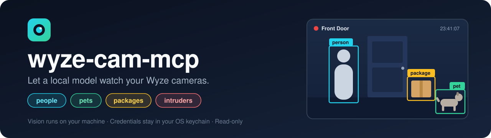
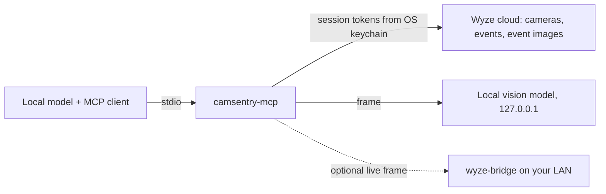

<p align="center">
  
</p>

<p align="center">
  <a href="https://github.com/14manj01/camsentry-mcp/actions/workflows/ci.yml"></a>
  <a href="LICENSE"></a>
  
  <a href="https://modelcontextprotocol.io"></a>
  
  <a href="SECURITY.md"></a>
</p>

<p align="center">
  <a href="#quick-start">Quick start</a> ·
  <a href="#tools">Tools</a> ·
  <a href="#how-alerts-are-decided">Alerts</a> ·
  <a href="#settings">Settings</a> ·
  <a href="#security">Security</a> ·
  <a href="#limitations">Limitations</a>
</p>

---

**camsentry-mcp** is an unofficial [MCP](https://modelcontextprotocol.io) server that gives a local model
eyes on Wyze cameras. Ask it *"is there a package at the front door?"* or *"arm the cameras and tell me if
anyone shows up"*, and it answers from what your cameras actually recorded.

> [!NOTE]
> **Independent project.** camsentry-mcp is not affiliated with, endorsed by or sponsored by Wyze Labs, Inc.
> "Wyze" and "Wyze Cam" are trademarks of Wyze Labs, Inc., used here only to say which cameras this
> software works with.

<table>
  <tr>
    <td align="center" width="25%">🧍<br><b>People</b><br><sub>Who is at the door, and how many</sub></td>
    <td align="center" width="25%">🐾<br><b>Pets</b><br><sub>Dogs, cats and other animals</sub></td>
    <td align="center" width="25%">📦<br><b>Packages</b><br><sub>Parcels left unattended</sub></td>
    <td align="center" width="25%">🚨<br><b>Intruders</b><br><sub>Anyone while armed, or acting suspiciously</sub></td>
  </tr>
</table>

## Why this one

<table>
  <tr>
    <td width="28%">🖥️ <b>Local vision</b></td>
    <td>Frames are analysed on your machine by a small vision model (default <code>gemma3:4b</code>, 3.3 GB) through Ollama, LM Studio or llama.cpp. A non-local endpoint is refused unless you opt in.</td>
  </tr>
  <tr>
    <td>🔐 <b>No stored passwords</b></td>
    <td>Your Wyze password and API key are typed once into a terminal prompt and discarded. Only session tokens are kept, in your operating system keychain. Never in files, environment variables or MCP configs.</td>
  </tr>
  <tr>
    <td>👀 <b>Read-only</b></td>
    <td>There is no tool that can switch a camera off, unlock anything or change a Wyze setting.</td>
  </tr>
  <tr>
    <td>💬 <b>Works with text-only models</b></td>
    <td>Detection results come back as plain JSON, so the chat model driving the tools does not need vision.</td>
  </tr>
</table>

## How it works



## Quick start

**You need:** Python 3.12 – 3.14, a Wyze account, [Ollama](https://ollama.com) (or another local model server),
and an OS keychain (Windows Credential Manager, macOS Keychain, or GNOME Keyring / KWallet on Linux).

**1. Install**

```sh
pipx install git+https://github.com/14manj01/camsentry-mcp
# or: uv tool install git+https://github.com/14manj01/camsentry-mcp
```

**2. Get a small vision model**

```sh
ollama pull gemma3:4b
```

It analyses a frame in about a second on a GPU that fits it.

**3. Connect your Wyze account**

Create a free API key at <https://developer-api-console.wyze.com/#/apikey/view>, then:

```sh
camsentry-mcp login
```

You are asked for your Wyze email, password, API Key ID and API Key (and a 2FA code if your account uses
one). They are exchanged for session tokens, the tokens are saved to the OS keychain, and the password and
API key are discarded.

```sh
camsentry-mcp status    # checks the Wyze session, the vision model and your settings
camsentry-mcp logout    # revokes the session with Wyze and deletes the tokens
```

**4. Add it to your MCP client**

Any MCP client that launches stdio servers works (LM Studio, Jan, Open WebUI via mcpo, ollmcp, …).
There are no secrets in this block, so it is safe to share or commit:

```json
{
  "mcpServers": {
    "camsentry": {
      "command": "camsentry-mcp",
      "env": {
        "CAMSENTRY_VISION_MODEL": "gemma3:4b",
        "CAMSENTRY_ARMED_HOURS": "22:00-06:00"
      }
    }
  }
}
```

**5. Ask**

> Check my cameras.
>
> Is there a package at the front door?
>
> Arm the cameras and tell me if anyone shows up.

## Tools

| Tool | What it does |
| --- | --- |
| `list_cameras` | Cameras on the account, online state, arming state. |
| `get_events` | Recent motion/sound events with Wyze's own AI tags. No vision model involved. |
| `watch_cameras` | Events that are new since the previous call, each analysed by the local vision model. Poll this to "watch". |
| `analyze_camera` | Run the vision model on one frame: counts of people and packages, pets, intruder alerts, one-line summary. |
| `view_camera` | Return the frame itself, for chat models that accept images. |
| `set_armed` | `on` / `off` / `schedule`: when a detected person counts as an intruder. |

<details>
<summary><b>Example result from <code>analyze_camera</code></b></summary>

```json
{
  "camera": "Front Door",
  "source": "event",
  "time": "2026-03-01T23:41:07-06:00",
  "wyze_tags": ["Person"],
  "armed": true,
  "detection": {"people": 1, "pets": [], "packages": 1, "suspicious": false, "suspicious_reason": "", "summary": "A courier places a box on the porch."},
  "alerts": [
    {"type": "person", "reason": "1 visible; tagged by Wyze"},
    {"type": "package", "reason": "1 visible"},
    {"type": "intruder", "reason": "person detected while armed"}
  ]
}
```

</details>

## How alerts are decided

| Alert | Raised when |
| --- | --- |
| 🧍 `person` | The local vision model sees a person, or Wyze tagged the event. |
| 🐾 `pet` | The local vision model sees an animal, or Wyze tagged the event. |
| 📦 `package` | The local vision model sees an unattended parcel, or Wyze tagged the event. |
| 🚨 `intruder` | A person is detected while the system is armed (`CAMSENTRY_ARMED_HOURS`, or `set_armed on`), **or** the vision model flags clearly suspicious behaviour such as testing a door or taking a package. |

Wyze's own tags need Cam Plus; the local model does not.

> [!NOTE]
> Detection quality is that of the vision model you choose. With the default `gemma3:4b`, "is there a
> person / pet / package" is dependable but head counts in busy scenes are approximate. Larger models are
> not required and can be too slow: if the model does not fit in GPU memory a frame can take minutes, longer
> than most MCP clients wait for a tool.

> [!WARNING]
> Treat alerts as a prompt to look, not as proof. Do not rely on this project as your only security system.

## Settings

All optional, all non-secret environment variables.

| Variable | Default | Meaning |
| --- | --- | --- |
| `CAMSENTRY_VISION_URL` | `http://127.0.0.1:11434/v1` | OpenAI-compatible endpoint of your local vision model server. |
| `CAMSENTRY_VISION_MODEL` | `gemma3:4b` | Vision model name on that server. |
| `CAMSENTRY_ALLOW_REMOTE_VISION` | unset | Set to `1` to allow a vision endpoint that is not on this machine. Camera frames will be sent there. |
| `CAMSENTRY_ARMED_HOURS` | unset | Daily local-time window, e.g. `22:00-06:00`, in which any person is an intruder. |
| `CAMSENTRY_BRIDGE_URL` | unset | Base URL of a [wyze-bridge](https://github.com/IDisposable/docker-wyze-bridge), e.g. `http://192.168.1.50:5080`, for live frames. |

<details>
<summary><b>Event images vs. live view</b></summary>

<br>

Out of the box the server sees what the Wyze app's Events tab sees: a still image per motion event. Without
Cam Plus, Wyze limits how often cameras record events.

For a frame from *right now*, run a wyze-bridge on your network and set `CAMSENTRY_BRIDGE_URL`.
`analyze_camera` and `view_camera` then use a live snapshot when no `event_id` is given. If the bridge has
`BRIDGE_AUTH` enabled, store its credentials in the keychain with `camsentry-mcp bridge-auth`.

</details>

## Security

> [!IMPORTANT]
> No secret is ever written to a file by this project, so there is nothing to accidentally commit.
> Plaintext and missing keychains are refused rather than silently used.

- 🖼️ Camera frames go to the vision endpoint only. It must be a loopback address unless you opt in.
- 🧱 Tools take camera names and event ids, never URLs or file paths.
- 🧹 Error messages and logs are scrubbed of tokens, pre-signed image URLs and raw Wyze responses.
- 🔎 This repository runs secret scanning (gitleaks) on every push and pull request.

The full threat model, including what a manipulated model can and cannot do, is in [SECURITY.md](SECURITY.md).

## Limitations

- Wyze has no official public API. This project uses the community
  [wyze-sdk](https://github.com/shauntarves/wyze-sdk), which can break when Wyze changes their service.
- Wyze's [Terms of Service](https://www.wyze.com/policies/terms-of-service) restrict third-party
  applications that interact with their service. Using this project with your account may breach those
  terms, and Wyze could suspend the account. That risk is yours to weigh.
- `watch_cameras` is a poll, not a push: the model (or your client's scheduler) has to call it.
- `set_armed` and the "already reported" memory of `watch_cameras` reset when the server restarts.

## Development

```sh
git clone https://github.com/14manj01/camsentry-mcp
cd camsentry-mcp
python -m venv .venv
.venv/bin/pip install -e ".[dev]"      # Windows: .venv\Scripts\pip
.venv/bin/pytest
```

---

<p align="center">
  <sub>Not affiliated with, endorsed by or sponsored by Wyze Labs, Inc. Wyze is a trademark of Wyze Labs, Inc.<br>Released under the <a href="LICENSE">MIT license</a>.</sub>
</p>
