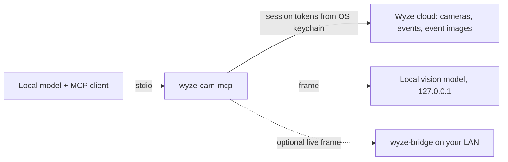

# wyze-cam-mcp

An [MCP](https://modelcontextprotocol.io) server that lets a **local model** watch your Wyze cameras and
report **people, pets, packages and intruders**.

- Detection runs on your machine, through any OpenAI-compatible local vision model (Ollama, LM Studio, llama.cpp).
- Your Wyze password and API key are typed once into a terminal prompt and never stored. The resulting
  session tokens live in your operating system keychain, not in files, environment variables or MCP configs.
- The server is read-only: it has no tool that can switch a camera off, unlock anything or change a Wyze setting.



## Requirements

- Python 3.12 – 3.14
- A Wyze account and a free Wyze API key: <https://developer-api-console.wyze.com/#/apikey/view>
- A small local vision model. The default is `gemma3:4b` (3.3 GB) on [Ollama](https://ollama.com):
  `ollama pull gemma3:4b`. It analyses a frame in about a second on a GPU that fits it.
- An OS keychain: Windows Credential Manager, macOS Keychain, or a Secret Service provider
  (GNOME Keyring, KWallet) on Linux

## Install

```sh
pipx install git+https://github.com/14manj01/wyze-cam-mcp
# or: uv tool install git+https://github.com/14manj01/wyze-cam-mcp
```

## Connect your Wyze account

```sh
wyze-cam-mcp login
```

You are asked for your Wyze email, password, API Key ID and API Key (and a 2FA code if your account uses
one). They are exchanged for session tokens, the tokens are saved to the OS keychain, and the password and
API key are discarded. Then check everything:

```sh
wyze-cam-mcp status
```

`wyze-cam-mcp logout` revokes the session with Wyze and deletes the tokens.

## Add it to your MCP client

Any MCP client that launches stdio servers works (LM Studio, Jan, Open WebUI via mcpo, ollmcp, …).
There are no secrets in this block, so it is safe to share or commit:

```json
{
  "mcpServers": {
    "wyze-cam": {
      "command": "wyze-cam-mcp",
      "env": {
        "WYZE_CAM_VISION_MODEL": "gemma3:4b",
        "WYZE_CAM_ARMED_HOURS": "22:00-06:00"
      }
    }
  }
}
```

Then ask your model things like *"Check my cameras"*, *"Is there a package at the front door?"* or
*"Arm the cameras and tell me if anyone shows up."*

## Tools

| Tool | What it does |
| --- | --- |
| `list_cameras` | Cameras on the account, online state, arming state. |
| `get_events` | Recent motion/sound events with Wyze's own AI tags. No vision model involved. |
| `watch_cameras` | Events that are new since the previous call, each analysed by the local vision model. Poll this to "watch". |
| `analyze_camera` | Run the vision model on one frame: counts of people and packages, pets, intruder alerts, one-line summary. |
| `view_camera` | Return the frame itself, for chat models that accept images. |
| `set_armed` | `on` / `off` / `schedule`: when a detected person counts as an intruder. |

The chat model does not need vision: `watch_cameras` and `analyze_camera` return plain JSON, for example

```json
{
  "camera": "Front Door",
  "source": "event",
  "time": "2026-03-01T23:41:07-06:00",
  "wyze_tags": ["Person"],
  "armed": true,
  "detection": {"people": 1, "pets": [], "packages": 1, "suspicious": false, "suspicious_reason": "", "summary": "A courier places a box on the porch."},
  "alerts": [
    {"type": "person", "reason": "1 visible; tagged by Wyze"},
    {"type": "package", "reason": "1 visible"},
    {"type": "intruder", "reason": "person detected while armed"}
  ]
}
```

### How alerts are decided

- **person / pet / package**: the local vision model sees one, or Wyze tagged the event (Wyze tags need Cam Plus).
- **intruder**: a person is detected while the system is armed (`WYZE_CAM_ARMED_HOURS`, or `set_armed on`),
  or the vision model flags clearly suspicious behaviour such as testing a door or taking a package.

Detection quality is that of the vision model you choose. With the default `gemma3:4b`, "is there a
person / pet / package" is dependable but head counts in busy scenes are approximate. Larger models are
not required and can be too slow: if the model does not fit in GPU memory a frame can take minutes, longer
than most MCP clients wait for a tool. Treat alerts as a prompt to look, not as proof, and do not rely on
this project as your only security system.

## Settings

All optional, all non-secret environment variables.

| Variable | Default | Meaning |
| --- | --- | --- |
| `WYZE_CAM_VISION_URL` | `http://127.0.0.1:11434/v1` | OpenAI-compatible endpoint of your local vision model server. |
| `WYZE_CAM_VISION_MODEL` | `gemma3:4b` | Vision model name on that server. |
| `WYZE_CAM_ALLOW_REMOTE_VISION` | unset | Set to `1` to allow a vision endpoint that is not on this machine. Camera frames will be sent there. |
| `WYZE_CAM_ARMED_HOURS` | unset | Daily local-time window, e.g. `22:00-06:00`, in which any person is an intruder. |
| `WYZE_CAM_BRIDGE_URL` | unset | Base URL of a [wyze-bridge](https://github.com/IDisposable/docker-wyze-bridge), e.g. `http://192.168.1.50:5080`, for live frames. |

### Event images vs. live view

Out of the box the server sees what the Wyze app's Events tab sees: a still image per motion event. Without
Cam Plus, Wyze limits how often cameras record events.

For a frame from *right now*, run a wyze-bridge on your network and set `WYZE_CAM_BRIDGE_URL`.
`analyze_camera` and `view_camera` then use a live snapshot when no `event_id` is given. If the bridge has
`BRIDGE_AUTH` enabled, store its credentials in the keychain with `wyze-cam-mcp bridge-auth`.

## Security

See [SECURITY.md](SECURITY.md) for the full model. In short:

- No secret is ever written to a file by this project, so there is nothing to accidentally commit.
  Plaintext and missing keychains are refused rather than silently used.
- Camera frames go to the vision endpoint only. It must be a loopback address unless you opt in.
- Tools take camera names and event ids, never URLs or file paths.
- Error messages and logs are scrubbed of tokens, pre-signed image URLs and raw Wyze responses.
- This repository runs secret scanning (gitleaks) on every push and pull request.

## Limitations

- Wyze has no official public API. This project uses the community
  [wyze-sdk](https://github.com/shauntarves/wyze-sdk), which can break when Wyze changes their service.
- `watch_cameras` is a poll, not a push: the model (or your client's scheduler) has to call it.
- `set_armed` and the "already reported" memory of `watch_cameras` reset when the server restarts.

## Development

```sh
git clone https://github.com/14manj01/wyze-cam-mcp
cd wyze-cam-mcp
python -m venv .venv
.venv/bin/pip install -e ".[dev]"      # Windows: .venv\Scripts\pip
.venv/bin/pytest
```

Not affiliated with or endorsed by Wyze Labs. MIT licensed.
